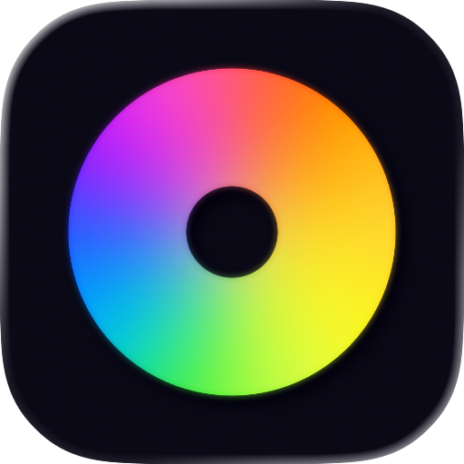
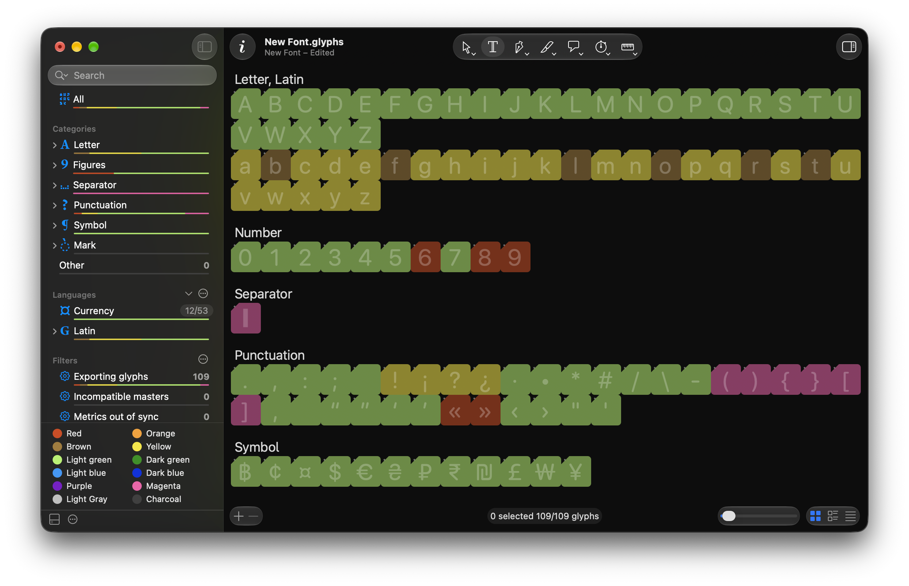
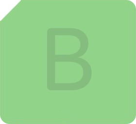
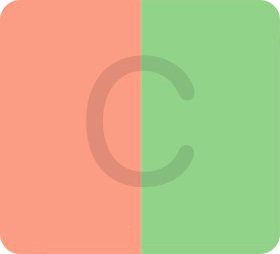
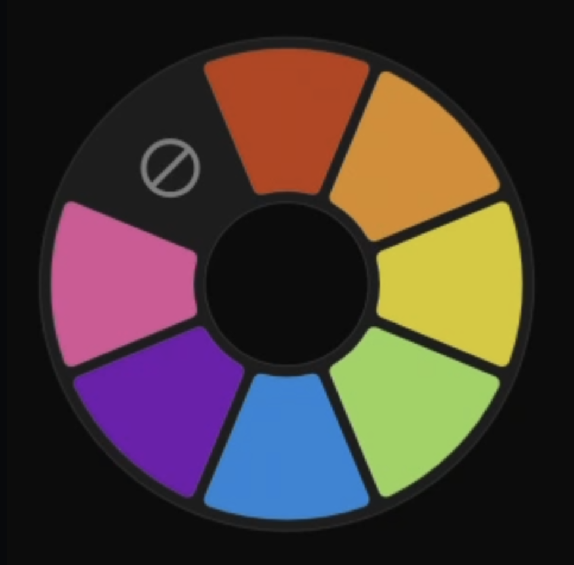
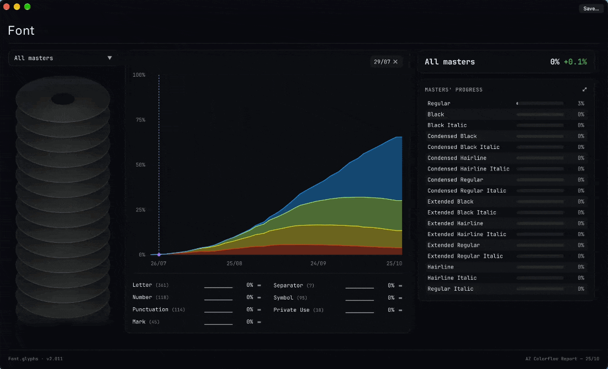

<p align="center">
  
</p>

<h1 align="center">AZ Colorflow</h1>

<p align="center">
  <strong>Track your progress better thanks to Layer color labels</strong>
</p>

<p align="center">
  <a><picture>
    <source media="(prefers-color-scheme: dark)" srcset="https://img.shields.io/badge/Free_Plugin-6690e3">
    
  </picture></a>
  <a href="https://azerty-typefaces.com"><picture>
    <source media="(prefers-color-scheme: dark)" srcset="https://img.shields.io/badge/More_AZ_plugins-242424">
    
  </picture></a>

</p>

---

<p align="center">
  
</p>

AZ Colorflow is a [GlyphsApp](https://glyphsapp.com/) plugin that helps you track progress in your project using Layer color labels. Give each color a meaning, color your layers as you work.

<br>

## Getting started

1. [Install AZ Colorflow in Glyphs 4](https://azerty-typefaces.github.io/AZ-Colorflow/install.html?v=4).

   Or open *Window ▸ Plugin Manager*, find **AZ Colorflow** and click *Install*.
2. Restart Glyphs.
3. Name and order your steps: open *Glyphs ▸ Settings…*, go to **AZ Toolkit** and choose **AZ Colorflow** in its popup.

AZ Colorflow needs Glyphs 4. It replaces the **Color Flow** plugin: if it is installed, disable or remove it.

<br>

## Glyph color vs layer color

Glyphs has color labels on two levels. Right-click a glyph to set its **glyph** color; hold Option to set its **layer** color. Glyph color fills the whole cell. Layer color fills the right half when a glyph color is also set, or the whole cell with a cut-out in the top-left corner when it is not.

<div align="center">

| Glyph color | Layer color | Glyph + layer color |
| :---: | :---: | :---: |
|  |  |  |

</div>

AZ Colorflow reads the **Layer** color, so each master tracks its own progress.

To set the layer color with a plain right-click, change *Default color label scope* in *Glyphs ▸ Settings… ▸ Advanced ▸ App*. The first time Glyphs starts with AZ Colorflow, it offers to do this for you.

More in the Glyphs Handbook: [Glyph & Layer Colors](https://handbook.glyphsapp.com/glyph-display/#glyph-and-layer-colors).

<br>

## Color wheel

<p align="center">
  
</p>

Select glyphs in the Font View, or layers in an Edit view, then hold <kbd>⌃</kbd> <kbd>⌥</kbd> and click on the glyphs or the canvas (keep the button down). A wheel of your steps opens at the cursor, in your order. Drag toward a color and let go: the selected layers take it.

Set your own chord in Settings: click the button next to **Show Color Wheel**, then hold any mix of <kbd>⌃</kbd> <kbd>⌥</kbd> <kbd>⌘</kbd> and click with the left, right or middle button. A left click needs at least one key. <kbd>⇧</kbd> can't be part of it, as it colors every master. Untick **Show Color Wheel** to turn the wheel off.

<br>

## Colorflow report

<p align="center">
  
</p>

Choose *File ▸ Open Colorflow Report…*. The report shows the colors you assigned over time in one stacked chart, a lane per glyph category and per script under it, and a panel that follows what you pick. It is a single HTML file that works offline; **Save…** in its title bar keeps a copy.

| In the report | Does |
| --- | --- |
| **Progress** | A weighted %: each glyph counts by its step, the first step worth 1 of N and the last N of N. Hover the number for the weights |
| **Masters' progress** | Every master, ranked. Click one, or its disc on the left, to see its colors, its recent updates and what changed |
| Progress by category or script | Click a lane to narrow the chart to its glyphs. Click it again, or press <kbd>Esc</kbd>, to see every glyph |
| The chart, or a day in the calendar | Picks that version. **Activity** then lists the glyphs whose color changed since the version before |
| <kbd>←</kbd> <kbd>→</kbd> · <kbd>↑</kbd> <kbd>↓</kbd> | Steps through the versions that changed · switches master |

Non-exporting glyphs never count. Without a version picked, **Activity** shows what changed since your last report before today; that starting point is kept in Glyphs' preferences, not in the file.

### Color history

The chart needs a history. The first time you open the report on a font, AZ Colorflow asks whether to keep one in the file. Say yes and each save stores a small compressed snapshot of the glyph colors inside your source file, so the history travels with it. Say no and nothing is written. Change it any time with **Keep color history in this file** in Settings, for the font in front.

A font tracked in git is never asked and nothing goes into its file: the history comes from its commits (the 300 most recent), each opened once and then cached on your Mac.

<br>

## Settings

Open *Glyphs ▸ Settings…*, go to **AZ Toolkit** and choose **AZ Colorflow** in its popup. The list shows the steps of the font in front, and your edits go where that font reads them (see [colorNames.txt](#colornamestxt)).

| Setting | Does |
| --- | --- |
| Double-click a name | Renames the step. Leave it empty to use the color's own name |
| Eye | Hides the color from the wheel, the sidebar bars and the report. It keeps its name |
| Drag a row | Reorders the steps. Hidden rows stay pinned below |
| ↻ | Resets names, order and hidden colors |
| **Sort Glyph Order by colors** | Groups the Font View by color (see [Font Glyph Order](#font-glyph-order)) |
| **Show color progress bars in Font View** | A color bar under each row of the Font View sidebar, and a legend under the list. Plus **Show bars behind categories** and **Show color meanings** |
| **Show Color Wheel** | Turns the color wheel on or off. The button next to it records the click that opens it |
| **Keep color history in this file** | Stores the font's colors at each save, for the [report](#colorflow-report)'s chart. Grayed for a font tracked in git, whose commits are its history |

<br>

## colorNames.txt

Your steps (their names, order and hidden colors) are saved in a `colorNames.txt` file. Edit them in Settings and the file is rewritten for you. AZ Colorflow uses the first one it finds:

1. **Next to the font:** `colorNames.txt` in the same folder as the `.glyphs` file, for that font only.
2. **Shared:** `~/Library/Application Support/Glyphs 4/info/colorNames.txt`, for every other font. It is created the first time you edit the steps in Settings.

Each line is a color and its step name, in step order. A line starting with `#` is a hidden color:

```
red=Sketched
orange=Drawn
yellow=Spaced
#brown=Old step
```

The color names are `red`, `orange`, `brown`, `yellow`, `lightGreen`, `darkGreen`, `lightBlue`, `darkBlue`, `purple`, `magenta`, `lightGray` and `charcoal`.

> **Sharing a font?** The steps are not saved inside the `.glyphs` file. To give collaborators the same workflow, put a `colorNames.txt` next to the `.glyphs` file (copy the shared one to start), and send it along with the font.

<br>

## Font Glyph Order

Groups the Font View into color sections, in the order of your steps. Colors that are not among your steps come next, and uncolored glyphs come last, under **No Color**. Turn it on with **Sort Glyph Order by colors** in Settings. It follows the selected master and updates when you recolor selected glyphs, add or remove glyphs, or change the steps.

The order is a `glyphOrder` custom parameter headed `#ColorFlow`. Your own glyph order is backed up when you turn it on and restored when you turn it off, ticked or unticked as it was. While it is on, the parameter is saved with the file and applies to exports too.

<br>

## Remove AZ Colorflow's data from a file

To strip a font of everything AZ Colorflow keeps in it (the color history, its own steps and the Font Glyph Order backup) and stop the color history, run this in *Window ▸ Macro Panel* with the font in front, then save it. With **Sort Glyph Order by colors** on, your own glyph order comes back first. Layer colors are Glyphs' own and stay.

```python
# Removes everything AZ Colorflow stored in the font in front, and turns its color
# history off. Run it in Window ▸ Macro Panel, then save the font.
font = Glyphs.font
data = font.userData

# With Sort Glyph Order by colors on, give the font its own glyph order back first.
if data["com.hugojourdan.ColorFlow.glyphOrderEnabled"]:
    saved = data["com.hugojourdan.ColorFlow.savedGlyphOrder"]
    if data["com.hugojourdan.ColorFlow.hadGlyphOrder"] and saved:
        font.customParameters["glyphOrder"] = saved
        was_active = data["com.hugojourdan.ColorFlow.savedGlyphOrderActive"]
        for parameter in font.customParameters:
            if parameter.name == "glyphOrder" and was_active is not None and not was_active:
                parameter.active = False
    else:
        del font.customParameters["glyphOrder"]

for key in (
    "com.hugojourdan.ColorFlow.timelineHistory",
    "com.hugojourdan.ColorFlow.timelineHistory.corrupt",
    "com.hugojourdan.ColorFlow.storeHistory",
    "com.hugojourdan.ColorFlow.colorNames",
    "com.hugojourdan.ColorFlow.glyphOrderEnabled",
    "com.hugojourdan.ColorFlow.savedGlyphOrder",
    "com.hugojourdan.ColorFlow.hadGlyphOrder",
    "com.hugojourdan.ColorFlow.savedGlyphOrderActive",
):
    if data[key] is not None:
        del data[key]

# Don't ask about keeping a history again for this file, on this Mac.
declined = "com.hugojourdan.ColorFlow.historyDeclined"
font.tempData[declined] = True
if font.filepath:
    Glyphs.defaults[declined] = list(Glyphs.defaults[declined] or []) + [font.filepath]
print("AZ Colorflow's data is gone from this font. Save it to keep the change.")
```

The report's "since your last report" starting point is kept in Glyphs' preferences, and a git-tracked font's commit snapshots in `~/Library/Caches/com.hugojourdan.ColorFlow`, never in the file.

<br>

## Feedback

Bugs and ideas go to the [issue tracker](https://github.com/azerty-typefaces/AZ-Colorflow/issues).

<br>

## Credits

Copyright © 2022–2026 [Hugo Jourdan](https://azerty-typefaces.com). All rights reserved.

Made possible with the GlyphsSDK by Georg Seifert (@schriftgestalt) and Rainer Erich Scheichelbauer (@mekkablue).
